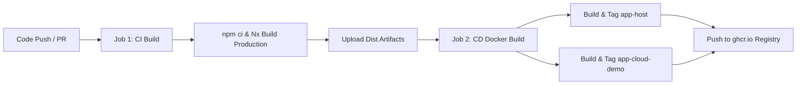

# Nx Angular Micro-Frontend Monorepo (app-host & app-cloud-demo)

Dự án Micro-Frontend xây dựng bằng **Nx**, **Angular 18**, và **Webpack Module Federation**.

---

## 🏗️ Cấu Trúc Dự Án (Architecture)

```text
cloud-demo/
├── apps/
│   ├── app-host/               # Host Application (Shell) - Cổng 4200
│   │   ├── src/
│   │   │   ├── app/
│   │   │   │   ├── dashboard/  # Dashboard tổng quan hệ thống Host
│   │   │   │   ├── app.routes.ts # Cấu hình Lazy-load Remote App qua Module Federation
│   │   │   │   └── app.component.*
│   │   │   └── bootstrap.ts
│   │   ├── module-federation.config.ts # Khai báo remotes: ['app-cloud-demo']
│   │   ├── webpack.config.ts
│   │   └── project.json
│   │
│   └── app-cloud-demo/         # Remote Application - Cổng 4201
│       ├── src/
│       │   ├── app/
│       │   │   └── remote-entry/ # Component & Routes export cho Host nạp động
│       │   │       ├── entry.component.ts # Giao diện Quản trị Cloud, VM, Storage
│       │   │       └── entry.routes.ts
│       │   └── bootstrap.ts
│       ├── module-federation.config.ts # Exposes: { './Routes': '.../entry.routes.ts' }
│       ├── webpack.config.ts
│       └── project.json
│
├── nx.json                     # Cấu hình Nx Monorepo
├── tsconfig.base.json          # TypeScript paths & base configuration
└── package.json                # Dependencies & scripts
```

---

## 🚀 Hướng Dẫn Khởi Chạy (Quick Start)

### 1. Khởi chạy toàn bộ hệ thống (Host + Remote)
Chỉ cần chạy 1 lệnh, Nx sẽ tự động khởi động cả Host và Remote:
```bash
npm start
# hoặc
npm run serve
```
- **App Host**: Truy cập tại `http://localhost:4200`
- **App Remote (app-cloud-demo)**: Tự động chạy tại `http://localhost:4201` và được nạp vào Host tại route: `http://localhost:4200/app-cloud-demo`

### 2. Khởi chạy riêng lẻ từng ứng dụng (Standalone Development)
Nếu bạn muốn dev độc lập từng micro-app:
```bash
# Chỉ chạy Host App
npm run serve:host

# Chỉ chạy Remote App (app-cloud-demo)
npm run serve:remote
```

### 3. Đóng gói cho môi trường Production (Build)
```bash
# Build tất cả các ứng dụng trong monorepo
npm run build

# Hoặc build riêng từng app
npm run build:host
npm run build:remote
```
Bản build hoàn tất được xuất ra thư mục `dist/apps/app-host` và `dist/apps/app-cloud-demo`.

### 4. Xem sơ đồ quan hệ Nx Project Graph
```bash
npm run graph
```

---

## ⚙️ Cơ Chế Hoạt Động (Module Federation Mechanism)

1. **Remote (`app-cloud-demo`)**:
   - File `apps/app-cloud-demo/module-federation.config.ts` export entry:
     ```typescript
     exposes: {
       './Routes': 'apps/app-cloud-demo/src/app/remote-entry/entry.routes.ts',
     }
     ```
   - Tạo ra file runtime `remoteEntry.mjs` trên cổng `4201`.

2. **Host (`app-host`)**:
   - Khai báo remote trong `apps/app-host/module-federation.config.ts`:
     ```typescript
     remotes: ['app-cloud-demo']
     ```
   - Nạp động route trong `apps/app-host/src/app/app.routes.ts`:
     ```typescript
     {
       path: 'app-cloud-demo',
       loadChildren: () => import('app-cloud-demo/Routes').then((m) => m.remoteRoutes),
     }
     ```

---

## 🔄 Luồng CI/CD (GitHub Actions & Docker)

Hệ thống được trang bị pipeline CI/CD tự động qua file cấu hình [`.github/workflows/ci-cd.yml`](file:///.github/workflows/ci-cd.yml):



### 1. Quy trình CI (Kiểm tra & đóng gói)
- Kích hoạt khi có `push` hoặc `pull_request` vào nhánh `main` / `master`.
- Cài đặt dependencies chuẩn xác bằng `npm ci`.
- Tự động biên dịch toàn bộ các ứng dụng sang chế độ Production với Nx.
- Lưu trữ build artifacts (`dist/apps/app-host` và `dist/apps/app-cloud-demo`) trên GitHub Actions (7 ngày).

### 2. Quy trình CD (Đóng gói Docker & Đẩy lên Container Registry)
- Tự động kích hoạt sau khi bước CI thành công trên nhánh chính (`main`/`master`).
- Xây dựng Docker images multi-stage siêu nhẹ dựa trên `nginx:1.25-alpine`:
  - `ghcr.io/<org>/app-host`: Container phục vụ Host Shell (đã cấu hình SPA fallback).
  - `ghcr.io/<org>/app-cloud-demo`: Container phục vụ Remote App (đã cấu hình **CORS** cho Module Federation).
- Sử dụng GitHub Actions Cache (`type=gha`) để tăng tốc build Docker tối đa.

### 3. Chạy thử nghiệm Docker nội bộ (Local Docker Compose)
Bạn có thể khởi chạy môi trường Production container hóa ngay trên máy bằng Docker Compose:

```bash
# Build lại các Docker image cho cả Host và Remote
npm run docker:build

# Khởi chạy các container chạy ngầm
npm run docker:up

# Dừng các container
npm run docker:down
```

- **Host App trên Docker**: `http://localhost:4200`
- **Remote App trên Docker**: `http://localhost:4201`

